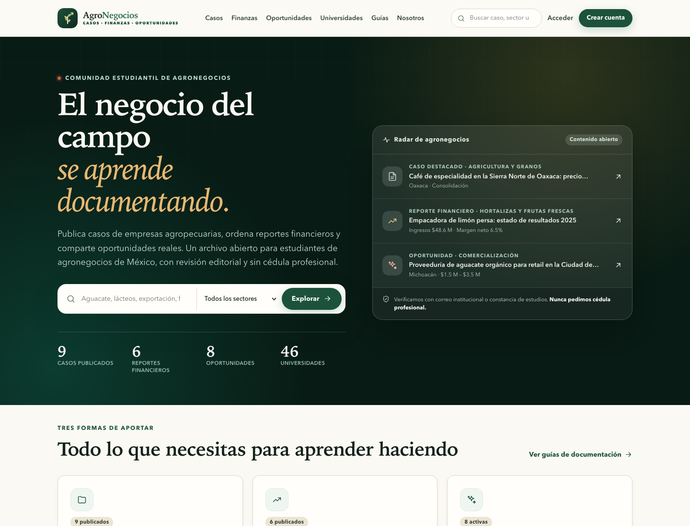
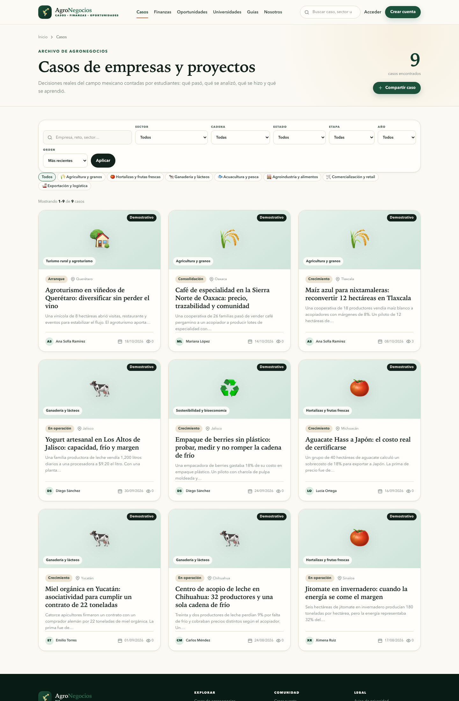
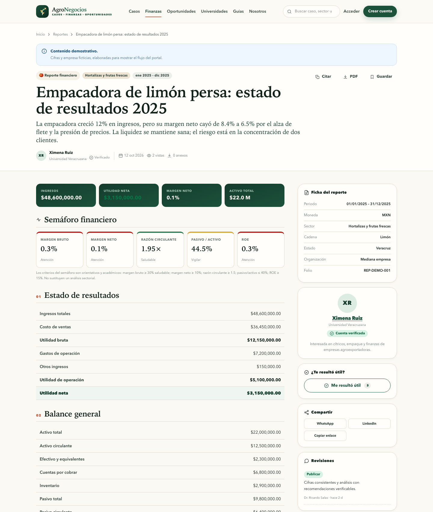
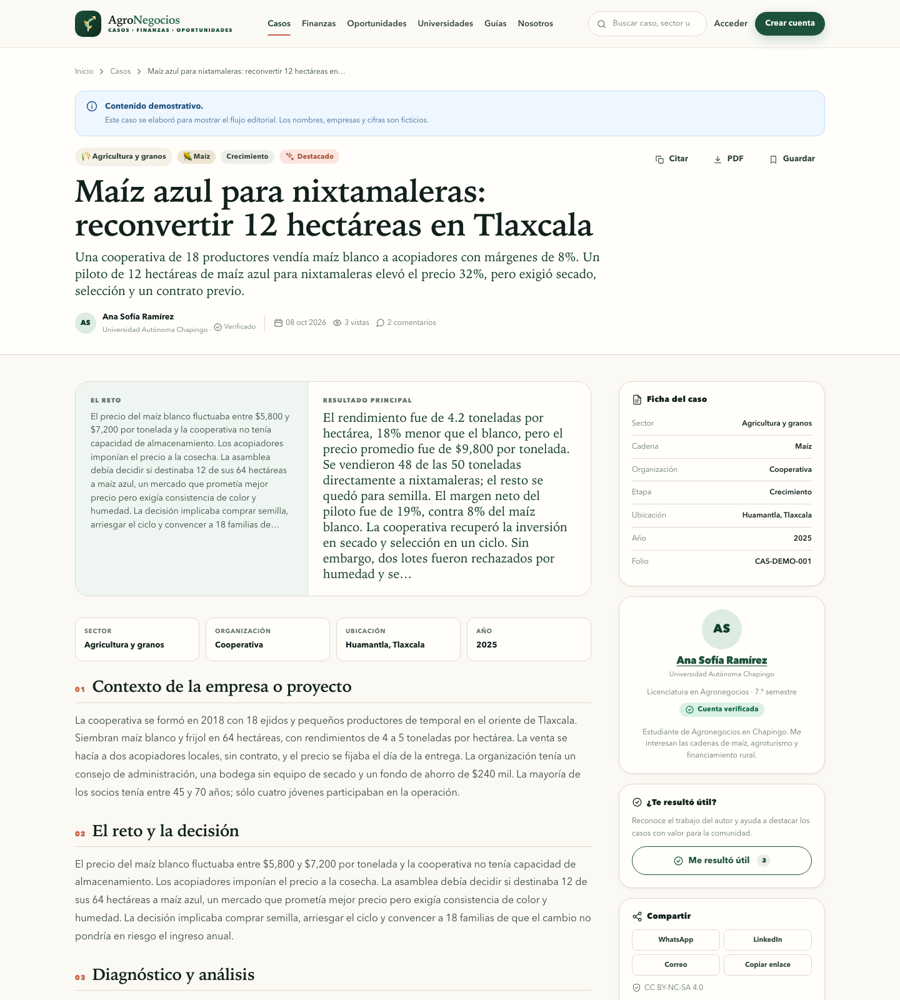
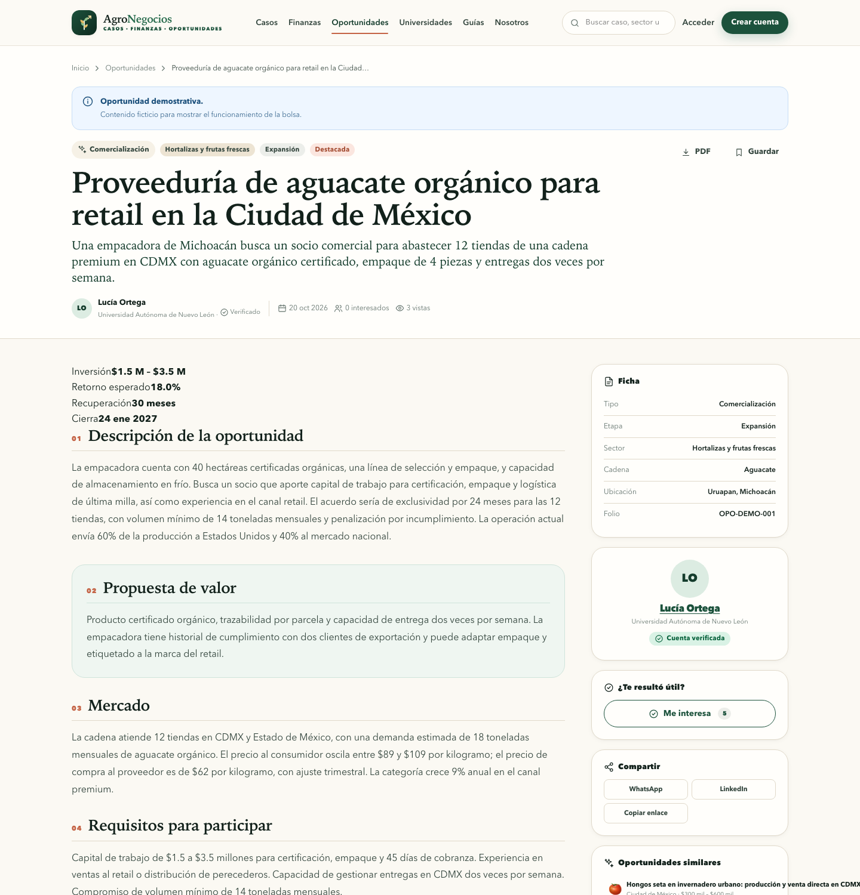
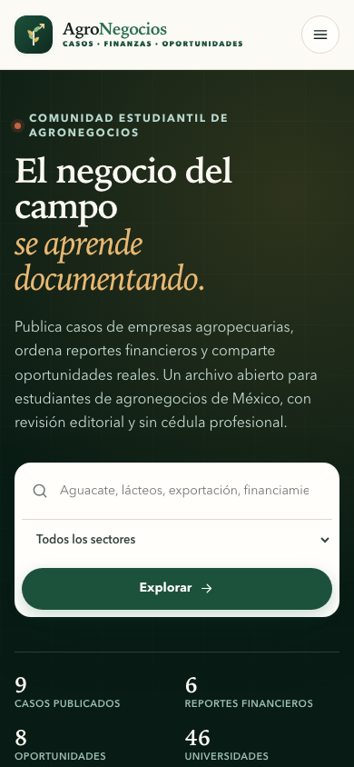
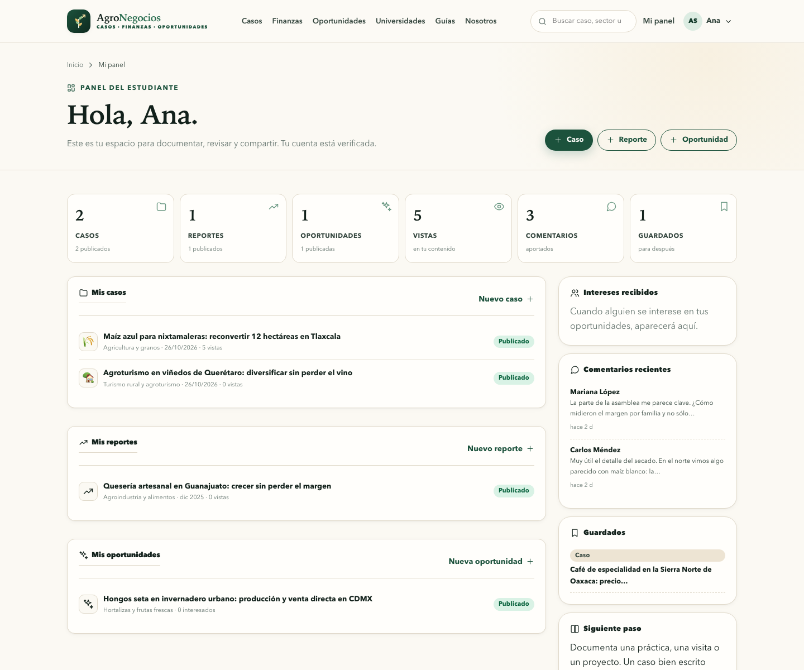
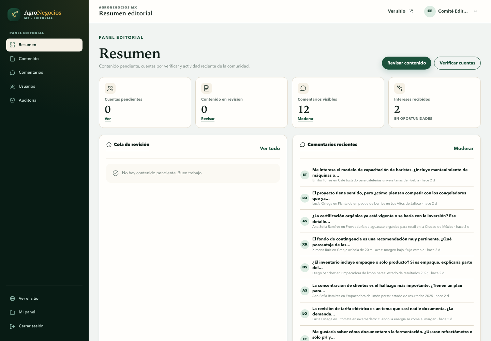

# AgroNegocios MX

**Comunidad de casos, reportes financieros y oportunidades para estudiantes de agronegocios de México.**

[](https://www.php.net/)
[](https://www.postgresql.org/)
[](LICENSE)

## Qué es

AgroNegocios MX es un portal en español para estudiantes y docentes de agronegocios de universidades mexicanas. Permite publicar y consultar:

- **Casos de agronegocios:** contexto de la empresa, reto, diagnóstico, estrategia, resultados y aprendizajes.
- **Reportes financieros:** estado de resultados, balance, indicadores calculados y análisis.
- **Oportunidades de negocio:** mercado, inversión, requisitos, riesgos y contacto.

> **Demo en línea:** <https://orchid-echidna-504216.hostingersite.com>
>
> Contenido demostrativo ficticio, nueve casos, seis reportes, ocho oportunidades y 46 universidades registradas.

La verificación es **académica**: correo institucional (`.edu.mx` o dominio universitario registrado) o constancia de estudios revisada por el comité. **No se solicita cédula profesional.**

> **Aviso educativo.** El contenido no sustituye asesoría financiera, legal o técnica. Las oportunidades no son ofertas de valores ni recomendaciones de inversión.

## Capturas

| Portada | Casos | Reporte financiero |
| --- | --- | --- |
|  |  |  |

| Caso | Oportunidad | Móvil |
| --- | --- | --- |
|  |  |  |

| Panel del estudiante | Panel editorial |
| --- | --- |
|  |  |

## Funcionalidades

### Estudiantes

- Registro con universidad, carrera, semestre, estado y semblanza.
- Verificación automática con correo institucional o manual con constancia de estudios.
- Casos con imágenes, secciones editoriales y exportación a PDF.
- Reportes financieros con cálculo automático de márgenes, liquidez, endeudamiento, ROE y ROA.
- Oportunidades con rango de inversión, retorno estimado, riesgos y contacto reservado opcional.
- Expresión de interés en oportunidades y gestión de interesados por parte del autor.
- Comentarios, reacciones, favoritos y perfil público.
- Panel personal con estado de cada publicación y retroalimentación editorial.
- Descarga de casos y reportes en PDF con folio, crédito y licencia.

### Comité editorial

- Cola de contenido en revisión por tipo (caso, reporte, oportunidad).
- Decisión de publicar, solicitar cambios o rechazar con notas para el autor.
- Verificación manual de cuentas y consulta de constancias privadas.
- Suspensión, reactivación y asignación de roles (`estudiante`, `docente`, `editor`, `admin`).
- Moderación de comentarios y registro de auditoría.

### Infraestructura

- PHP 8.2+ sin Composer ni frameworks.
- PostgreSQL en Neon con búsqueda full-text en español.
- Conexión por `pdo_pgsql` (TCP con TLS) o por HTTPS si el hosting no permite PostgreSQL.
- Diseño responsive con CSS propio y JavaScript sin dependencias.
- Protección CSRF, contraseñas con `password_hash`, validación de archivos y límites de intentos de acceso.

## Stack

| Capa | Tecnología |
| --- | --- |
| Lenguaje | PHP 8.2+ con `declare(strict_types=1)` |
| Base de datos | PostgreSQL 15+ en Neon; `pg_trgm`, `citext`, `tsvector` |
| Acceso a datos | `pdo_pgsql` o endpoint SQL HTTPS de Neon |
| Servidor | Apache/LiteSpeed en Hostinger; `php -S` en local |
| Frontend | HTML semántico, CSS propio, JavaScript sin dependencias |
| Correo | `mail()` de PHP, opcional con `MAIL_ENABLED=true` |

## Arquitectura

```text
Navegador
   │ HTTPS
   ▼
Hostinger · public_html
   ├─ .htaccess              redirige a public/ y bloquea rutas sensibles
   ├─ public/index.php       front controller
   ├─ app/Core               router, request, sesión, CSRF, BD, vistas
   ├─ app/Controllers        casos, reportes, oportunidades, cuenta, admin
   ├─ app/Repositories       SQL parametrizado por dominio
   ├─ app/Services           verificación de estudiantes
   ├─ app/Views              plantillas PHP con layouts
   └─ database/              migraciones y seeds
          │
          └─ pdo_pgsql (TLS) ──► Neon PostgreSQL
```

- Sin ORM: consultas SQL con marcadores `$1, $2, …` y repositorios.
- Sin Composer: autoloader mínimo para `App\`.
- Migraciones y seeds se ejecutan por CLI, nunca desde el navegador.
- La verificación de estudiantes vive en `app/Services/StudentVerifier.php`.

## Modelo de datos

| Tabla | Propósito |
| --- | --- |
| `users` | Cuenta, rol, estado, universidad, carrera, semestre, matrícula privada y método de verificación. |
| `cases` | Caso de agronegocios con contexto, reto, diagnóstico, estrategia, resultados y `search_vector`. |
| `case_images` | Imágenes del caso. |
| `reports` | Reporte financiero con cifras, análisis y `search_vector`. |
| `report_files` | Anexos PDF/XLSX/CSV/DOCX. |
| `opportunities` | Oportunidad con mercado, inversión, retorno, requisitos y riesgos. |
| `comments`, `reactions`, `bookmarks` | Discusión, reacciones y favoritos genéricos por tipo de contenido. |
| `reviews` | Decisiones editoriales e historial. |
| `interests` | Expresiones de interés en oportunidades. |
| `universities`, `states`, `sectors`, `chains` | Catálogos. |
| `audit_log`, `login_attempts`, `password_resets` | Auditoría, seguridad y recuperación. |

Las migraciones están en [`database/migrations`](database/migrations) y los catálogos en [`database/seeds`](database/seeds).

## Inicio rápido local

### Requisitos

- PHP 8.2+ con `pdo_pgsql`, `curl`, `mbstring`, `fileinfo`, `gd`, `intl` y `zip`.
- PostgreSQL 15+ o una base Neon.
- `psql` opcional.

```bash
cp .env.example .env
# Edita DATABASE_URL y APP_URL
php bin/migrate.php
php bin/seed.php
php bin/create-admin.php \
  --name="Comité Editorial" \
  --email="admin@tu-dominio.mx" \
  --password="UnaClaveLargaYUnica" \
  --state=CMX
php -S 127.0.0.1:8080 -t public
```

Abre <http://127.0.0.1:8080>.

### Verificación

```bash
php bin/check.php
```

Comprueba extensiones, permisos, conexión, migraciones y conteos.

### Cuentas demostrativas

`php bin/seed.php` crea ocho cuentas de ejemplo y contenido ficticio marcado como **Demostrativo**:

| Correo | Perfil |
| --- | --- |
| `ana.ramirez@chapingo.mx` | Estudiante, Chapingo |
| `carlos.mendez@uach.mx` | Estudiante, UACH |
| `lucia.ortega@uanl.mx` | Estudiante, UANL |
| `diego.sanchez@udg.mx` | Estudiante, UdeG |
| `mariana.lopez@buap.mx` | Estudiante, BUAP |
| `emilio.torres@uady.mx` | Estudiante, UADY |
| `ximena.ruiz@uv.mx` | Estudiante, UV |
| `ricardo.salas@uaaan.mx` | Docente y editor |

Contraseña: `DemoAgro2026!`. **Cámbiala o elimina estas cuentas en producción.**

El administrador se crea con `bin/create-admin.php`; no se siembra por defecto.

## Verificación sin cédula

1. El registro captura correo, universidad, carrera, semestre, estado y, opcionalmente, constancia de estudios.
2. Si el dominio del correo pertenece a una universidad registrada o termina en `.edu.mx`, la cuenta queda `verificado` con método `dominio_institucional`.
3. Si el correo es personal, la cuenta queda `pendiente`; el estudiante puede subir una constancia PDF/JPG/PNG y un editor la revisa.
4. Las constancias se guardan en `storage/constancias/` (fuera del árbol público) y sólo se sirven por `/admin/constancias/...` a administradores.

No hay campo de cédula profesional en el esquema, los formularios, las vistas ni los seeds.

## Despliegue en Hostinger

La guía completa está en [`docs/DESPLIEGUE-HOSTINGER.md`](docs/DESPLIEGUE-HOSTINGER.md). Resumen:

1. Subir el proyecto a `public_html` (el `.htaccess` raíz redirige a `public/`).
2. Crear `.env` de producción con `APP_URL` y `DATABASE_URL` (Neon directo + `options=endpoint%3D…`).
3. `chmod 600 .env`; `storage/` y `public/uploads/` escribibles.
4. Ejecutar migraciones y seeds desde local o por SSH.
5. Probar `/salud`, registro, publicación y PDF.

## Seguridad

- Contraseñas con `PASSWORD_DEFAULT` (bcrypt/Argon2 según PHP).
- CSRF en todos los formularios y acciones POST.
- Cookies de sesión `HttpOnly`, `SameSite=Lax` y `Secure` en HTTPS.
- Validación de MIME real, tamaño y dimensiones de imágenes; documentos con lista blanca.
- `.htaccess` bloquea `app/`, `config/`, `database/`, `storage/`, `.env` y la ejecución de PHP en uploads.
- Intentos de acceso limitados por correo e IP.
- Auditoría de acciones editoriales y de cuenta.

> **Credenciales.** Rota la contraseña de Neon y la del administrador después de la puesta en marcha. No publiques `.env` ni cadenas de conexión en el repositorio.

## Licencia

Código bajo licencia MIT. El contenido publicado por los autores se rige por la licencia que cada publicación declare (por defecto `CC BY-NC-SA 4.0`).

Hecho en México · Español · 2026.
